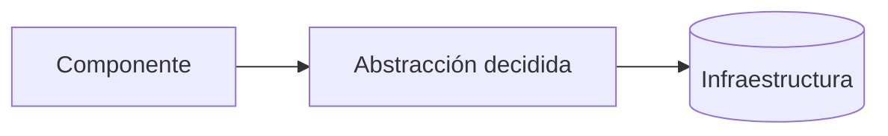

# ADR-<NNN>: <Título de la decisión>

- **Estado:** Propuesto | Aceptado | Reemplazado por ADR-<NNN> | Obsoleto
- **Fecha:** <AAAA-MM-DD>
- **Decisores:** <rol / equipo — o "Suposición — confirmar">
- **Reemplaza a:** <ADR-<NNN> | N/A>

---

## Contexto

Qué problema o fuerza motivó la decisión (requerimiento, AC, restricción técnica, incidente).
Citar evidencia: `archivo:línea`, issue/work item, commit. Lo que no conste en ninguna fuente se
marca **"Suposición — confirmar con el equipo"**.

---

## Decisión

Qué se decidió, en una o dos oraciones en presente ("Usamos X para Y"). Luego el detalle mínimo
para entenderla.

Dónde se materializa:

- `[EXISTE src/ruta/archivo.ext:NN]` — qué parte de la decisión implementa
- `[A CREAR src/ruta/nuevo.ext]` — (solo en ADRs de diseño)

---

## Alternativas consideradas

| Alternativa | Por qué se descartó |
|---|---|
| Opción A | <motivo concreto> |
| Opción B | <motivo concreto> |

---

## Consecuencias

**Positivas**

- ...

**Negativas / costos aceptados**

- ...

**Riesgos y cómo se mitigan**

- ...

---

## Cómo verificar que se cumple

Qué señal en el código o en los tests indica que la decisión se respeta (regla de lint, test de
arquitectura, convención revisable en code review).

---

## Notas

Detalles técnicos adicionales, links a specs, ADRs relacionados.
