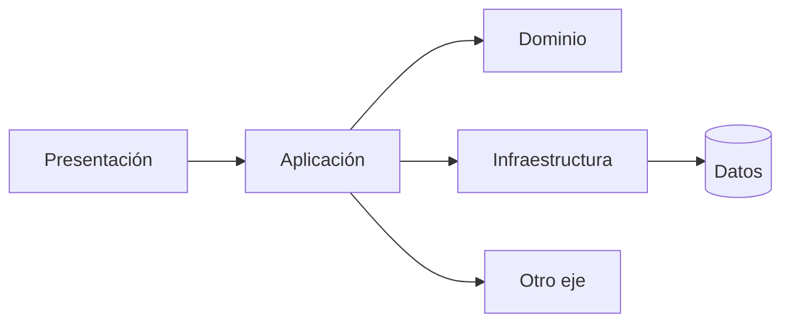
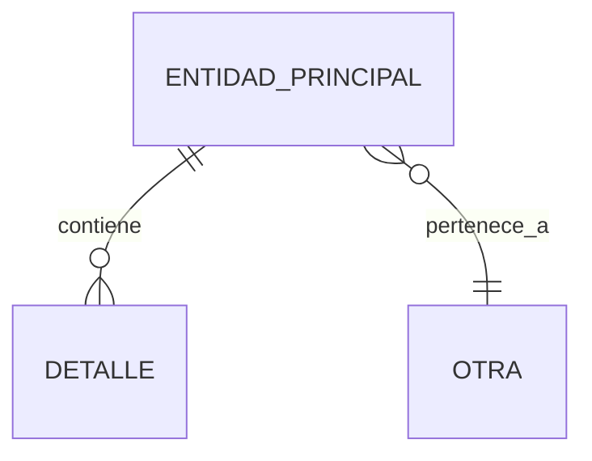

# <Eje>: <Nombre legible> (`<valor>`)

## Contexto

Este documento es el **mapa de `<valor>`** — un valor del eje de §6 del perfil del proyecto. Cubre
los casos de uso que contiene, módulos, flows, modelo de datos, integraciones y la distribución en
capas. Usar como punto de entrada para navegar la documentación de `<valor>`.

- **Casos de uso soportados:** <los del frontmatter>
- **Entidad principal:** `<entidad>` — y su relación con el resto del modelo
- **Dueño / equipo:** <si consta; si no, omitir>

---

## Resumen de negocio

Qué representa `<valor>` en el negocio, qué actores lo usan y cuál es su criticidad aproximada.
3-5 oraciones, sin nombres de clases, con el vocabulario de §9 del perfil.

---

## Catálogo del eje

Qué contiene `<valor>`. Usar las columnas que apliquen al tipo de proyecto y borrar el resto:

- **Backend / API:** endpoints o recursos · métodos · autenticación
- **Frontend / mobile:** páginas o pantallas · rutas · roles que las ven
- **Data:** pipelines · fuentes · destinos · frecuencia
- **Librería / CLI:** API pública · comandos · flags

| Elemento | Tipo | Detalle | Ubicación |
|---|---|---|---|
| `<elemento>` | endpoint / pantalla / job / comando | … | `src/ruta:NN` |

---

## Mapa de módulos

| Módulo | Responsabilidad principal | Documento |
|---|---|---|
| <Módulo 1> | 1 línea | `docs/conceptos/<eje>/module-<eje>-<nombre>.md` |

> ⚠️ Módulos pendientes de documentar: listar acá los que aún no tienen documento.

---

## Mapa de flows

| Flow | Caso de uso | Disparado por | Documento |
|---|---|---|---|
| <Flow 1> | <caso de uso> | UI / API / evento / job | `docs/conceptos/<eje>/flow-<eje>-<proceso>.md` |

> ⚠️ Flows pendientes de documentar: listar acá los casos de uso sin flow aún.

---

## Capas y dependencias

Cómo se reparte `<valor>` entre capas y de qué otros ejes depende. Leer de arriba hacia abajo.

| Capa | Ubicación / patrón | Qué hace |
|---|---|---|
| Presentación (UI / handlers) | `<ruta>` | … |
| Aplicación (casos de uso / servicios) | `<ruta>` | … |
| Dominio (entidades, reglas) | `<ruta>` | … |
| Infraestructura (repositorios, clientes, colas) | `<ruta>` | … |
| Código generado / vendorizado (§3) | `<ruta>` | desde qué se genera — no se edita a mano |

---

## Modelo de datos

Solo las relaciones estructuralmente relevantes, con los nombres **reales** del esquema.

| Entidad / tabla | Definida en | Campos clave | Notas (soft delete, tenant, auditoría…) |
|---|---|---|---|
| `<Entidad>` | `ruta/schema:NN` | … | … |

Migraciones que definen el modelo: `ruta/migrations/` — las relevantes y qué introducen.

---

## Enums y estados clave

Solo los que gobiernan lógica de negocio (máquinas de estado, tipos que bifurcan comportamiento).

| Enum / estado | Valores relevantes | Qué bifurca | Ubicación |
|---|---|---|---|
| `<Estado>` | `PENDIENTE`, `APROBADO`, … | … | `src/ruta:NN` |

---

## Proceso central

La lógica que **define** `<valor>` (cálculo de precio, conciliación, scoring, matching, ruteo…).

- **Estrategia:** <interna / servicio externo / mixta>
- **Componente principal:** `src/ruta/archivo.ext:NN`
- **Parámetros clave:** <config, flags, tablas de parámetros — ver §2 del perfil>
- **Integración externa (si aplica):** sistema, endpoint, cuándo se llama

---

## Jobs, eventos y tareas asíncronas

**Omitir la sección si el eje no tiene procesamiento asíncrono.**

| Job / consumidor / evento | Disparo (cron, cola, webhook) | Acción | Ubicación |
|---|---|---|---|
| `<nombre>` | … | … | `src/ruta:NN` |

---

## Configuración y feature flags

| Variable / flag | Qué controla | Leída en |
|---|---|---|
| `<NOMBRE>` | … | `src/ruta:NN` |

---

## Integraciones externas

| Sistema | Tipo | Dirección | Módulo responsable |
|---|---|---|---|
| `<Sistema>` | REST / gRPC / GraphQL / cola / webhook / SDK | entrante / saliente | `src/ruta` |

---

## Riesgos y deuda técnica

- **Riesgo:** descripción concreta y cuándo puede manifestarse (`archivo:línea`).
- **Deuda:** qué habría que refactorizar y por qué no se hizo aún.
