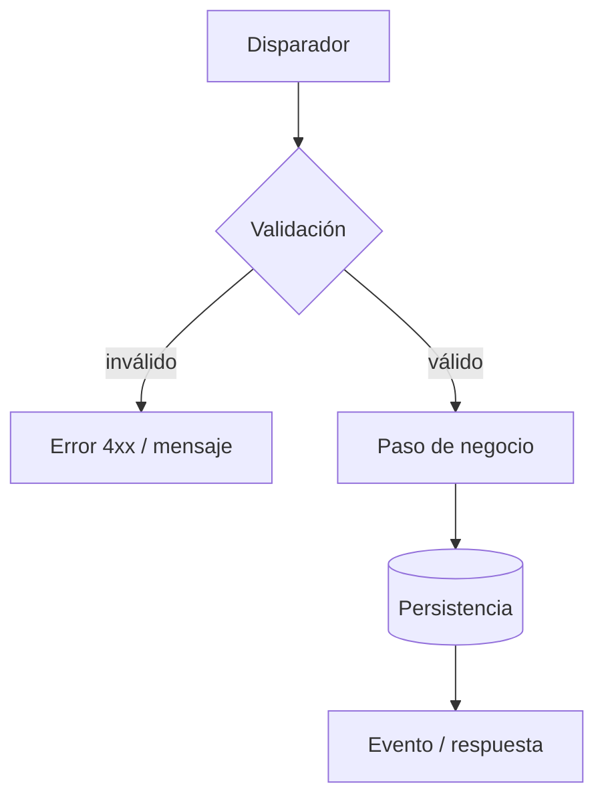

# Flujo: <Nombre del flujo>

## Descripción

Qué proceso de negocio cubre el flujo <nombre>, quién lo dispara y cuál es el resultado observable
(estado persistido, respuesta, mensaje emitido). 2-4 oraciones, vocabulario de §9.

---

## Disparador

- **Tipo:** endpoint HTTP / acción de UI / evento / job / comando CLI / webhook
- **Ubicación:** `src/ruta/archivo.ext:NN`
- **Precondiciones:** autenticación, rol, estado previo requerido

---

## Diagrama

<!-- Si intervienen 2+ participantes que intercambian mensajes, agregar además un sequenceDiagram. -->

---

## Pasos

| # | Paso | Componente | Ubicación |
|---|---|---|---|
| 1 | … | `<Componente>` | `src/ruta:NN` |

---

## Puntos de decisión

| Condición | Rama A | Rama B | Ubicación |
|---|---|---|---|
| `<condición>` | … | … | `src/ruta:NN` |

---

## Mutaciones de datos

| Entidad / tabla | Operación | Transacción | Ubicación |
|---|---|---|---|
| `<Entidad>` | crea / actualiza / borra | <misma tx / separada / sin tx> | `src/ruta:NN` |

Eventos emitidos: `<evento>` → `<cola/tópico>` (`src/ruta:NN`).

---

## Integraciones y configuración

| Sistema / config | Uso en el flujo | Timeouts / retries / idempotencia | Ubicación |
|---|---|---|---|
| … | … | … | `src/ruta:NN` |

---

## Manejo de errores

| Falla | Comportamiento | Ubicación |
|---|---|---|
| … | reintento / compensación / error al cliente / dead-letter | `src/ruta:NN` |

---

## Corte del flujo

Dónde termina la documentación y por qué (p. ej. "delega en <librería>@<versión>").

---

## Suposiciones y pendientes

- Suposición: …
