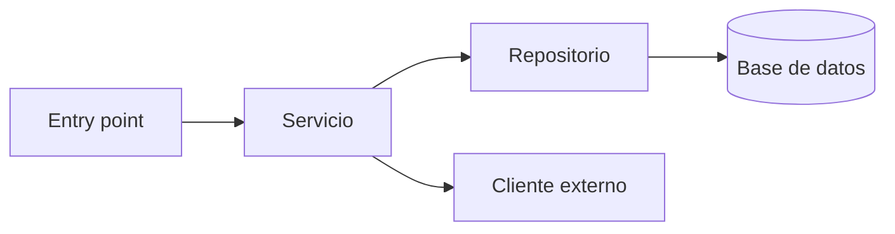

# Módulo: <Nombre del módulo>

## Responsabilidad

Qué hace el módulo <nombre> en el negocio y en el sistema, en 2-4 oraciones (vocabulario de §9).
Qué **no** hace (límites con otros módulos).

---

## Entry points

| Entry point | Tipo | Ubicación |
|---|---|---|
| `POST /recurso` | endpoint HTTP | `src/ruta/controller.ext:NN` |
| `<NombreJob>` | job / cron / consumidor de cola | `src/ruta/job.ext:NN` |
| `<Pantalla>` | página / pantalla | `src/ruta/page.ext:NN` |

---

## Componentes principales

| Componente | Rol (capa) | Responsabilidad | Ubicación |
|---|---|---|---|
| `<Nombre>` | controller / servicio / repositorio / componente UI / hook / store | 1 línea | `src/ruta:NN` |

---

## Modelo de datos

Entidades/tablas/esquemas que el módulo <nombre> lee o escribe.

| Entidad / tabla | Definida en | Campos clave | Acceso |
|---|---|---|---|
| `<Entidad>` | `ruta/schema-o-modelo:NN` | `id`, `estado`, … | lectura / escritura |

Migraciones relevantes: `ruta/migrations/<archivo>` — qué cambian.

---

## Configuración y feature flags

| Variable / flag | Qué controla | Default | Leída en |
|---|---|---|---|
| `NOMBRE_VARIABLE` | … | … | `src/ruta:NN` |

---

## Dependencias

- **Internas:** otros módulos que usa el módulo <nombre> (con ruta).
- **Librerías clave:** dependencias de terceros que definen su comportamiento (con versión del lockfile).

---

## Integraciones externas

| Sistema | Protocolo | Dirección | Timeouts / retries / errores | Ubicación |
|---|---|---|---|---|
| `<Sistema>` | HTTP / gRPC / cola / webhook / SDK | entrante / saliente | … | `src/ruta:NN` |

---

## Reglas de negocio relevantes

- <regla> — `src/ruta:NN`

---

## Riesgos y deuda técnica

- **Riesgo:** descripción concreta y cuándo puede manifestarse (`archivo:línea`).
- **Deuda:** qué habría que refactorizar y por qué.

---

## Suposiciones y pendientes

- Suposición: … (por qué no se pudo verificar)
- [A CONFIRMAR] …
